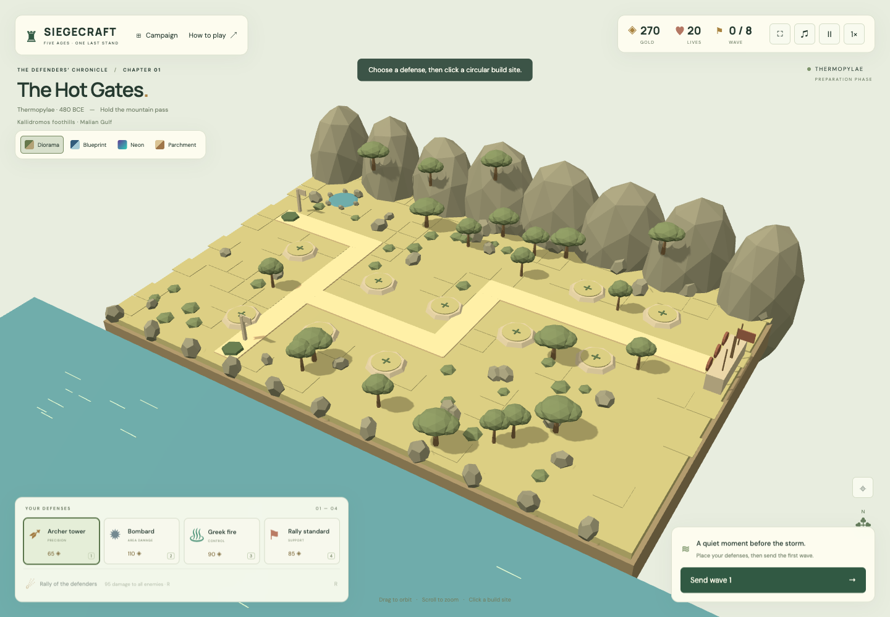
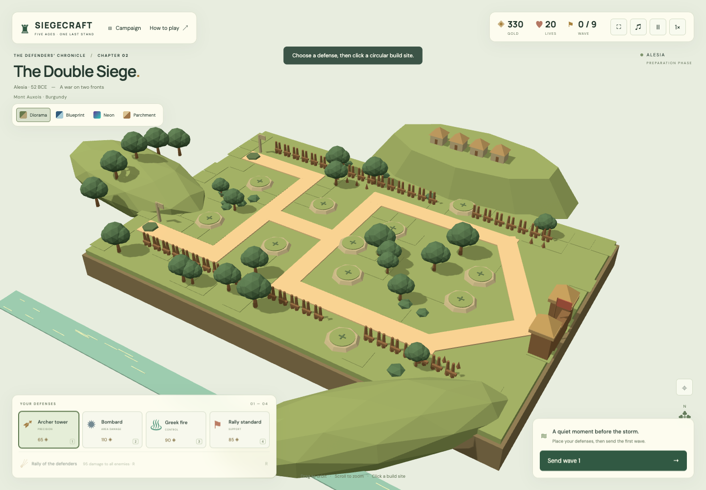
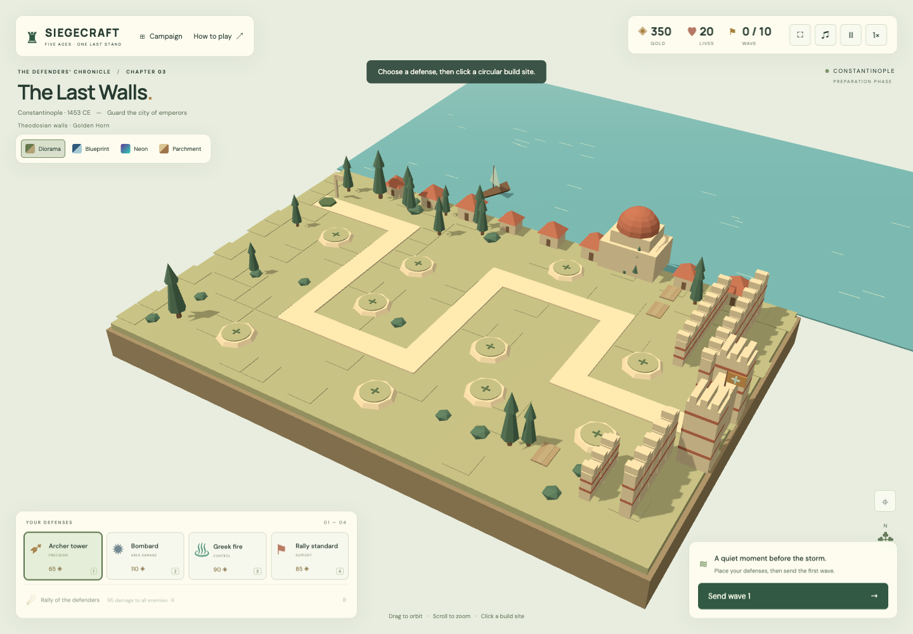
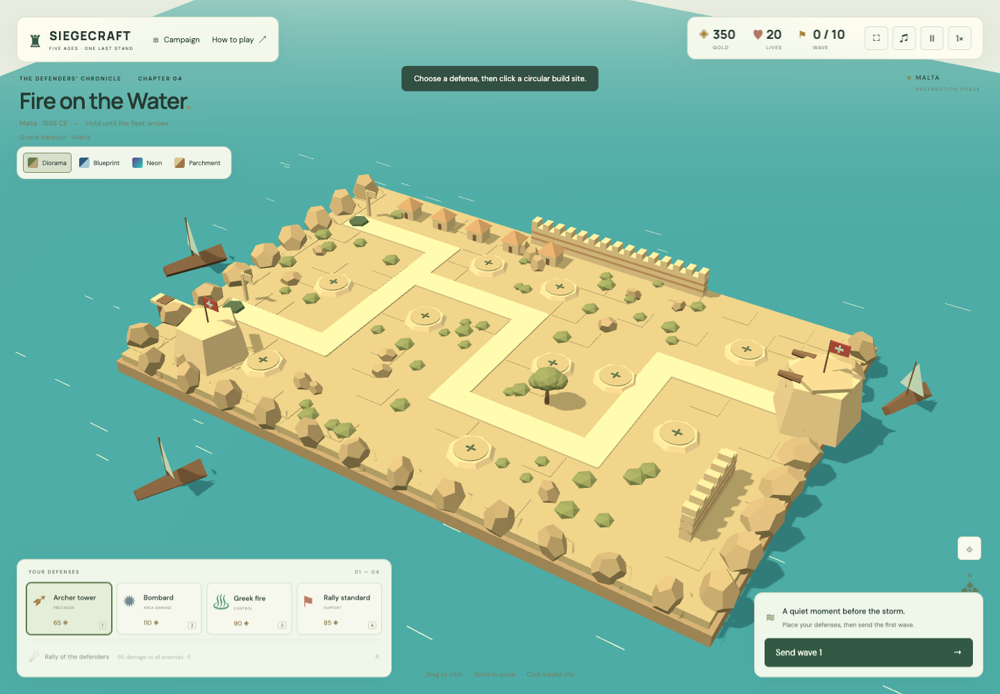
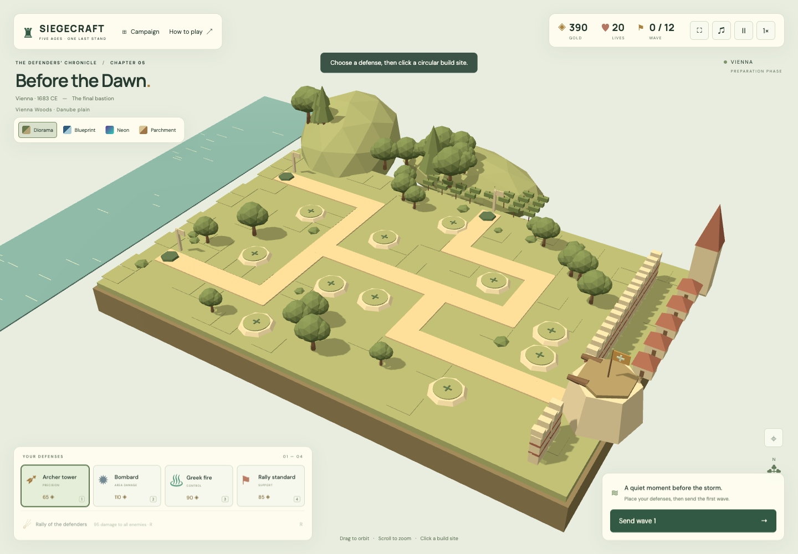

# The Hot Gates — Siegecraft · Five Ages

Developed by **GPT 6.1 Sol High** (`gpt-6.1-sol`, high reasoning effort). This implementation lives on the **`feat/gpt-6.1-sol-high`** branch.



A real-time 3D browser tower defense game, built with Three.js and Vite. Design is drawn from the two research documents in the [`docs/`](docs/) directory. Historical scenarios are gameplay adaptations, not historical simulations.

## Run

This project is local-only. Do not publish or deploy it unless explicitly requested. The development and preview servers bind to the loopback interface.

Requires Node.js 20.19+ or 22.12+.

```sh
git clone --branch feat/gpt-6.1-sol-high https://github.com/alhoseany/the-hot-gates.git
cd the-hot-gates
npm ci
npm run dev
```

Open the Local URL printed by Vite. `npm run build` creates a self-contained static deployment in `dist/`; `npm run preview` serves that production build. WebGL is required. The optional Google Fonts request falls back to system fonts when offline; the game itself has no runtime CDN dependencies.

## Play

Choose a tower, then click a circular build site. Click a built tower to upgrade (three tiers) or sell for 70% of its total investment. Send each wave manually. Earn gold from kills and wave completion; hold the final wave with at least one life to win. A boss escaping costs four lives.

- **Archer:** inexpensive precision damage; reduced damage against armor.
- **Bombard:** slow, armor-piercing splash damage.
- **Greek fire:** alchemical control tower that slows targets.
- **Rally standard:** nearby towers deal 35% more damage. Multiple standards do not stack.
- **Rally ability:** 95 damage to every active enemy and a short slow; 27-second cooldown.

The Three.js battlefield fills the browser window, with controls overlaid on the scene. Use **F** or the **⛶** button to enter or exit browser fullscreen.

Keys: **1–4** choose defenses, **Space** pause, **R** rally, **Escape** clear selection. Drag to orbit; wheel or pinch to zoom. Sound starts muted. All five levels are selectable. Victories and visual preferences are saved locally when browser storage is available. Opening a dialog pauses combat.

## Campaign and graphics

1. **Thermopylae** — 8 waves; second approach opens on wave 5.
2. **Alesia** — 9 waves; two simultaneous fronts.
3. **Constantinople** — 10 waves; 15 gold repairs after each wave.
4. **Malta** — 10 waves; 70 gold relief supplies after waves 3 and 6.
5. **Vienna** — 12 waves; three converging approaches.

Switch graphics mid-game: **Diorama** (flat-shaded miniature), **Blueprint** (wireframe drafting), **Neon** (emissive night palette), **Parchment** (warm sepia). All styles share the same gameplay and 3D geometry.

## Screenshots

Captured from the running Three.js game in Diorama style. Use the in-game style selector to switch to Blueprint, Neon or Parchment.

| Alesia — wooded hills and siege lines | Constantinople — walls and waterfront |
| --- | --- |
|  |  |

| Malta — limestone harbors | Vienna — wooded slopes and vineyards |
| --- | --- |
|  |  |

## Verification

```sh
npm test
npm run build
npx playwright install chromium
node tests/browser.mjs
```

Browser smoke tests expect a dev server on port 5174 by default. Override `GAME_URL` and optionally `CHROMIUM_PATH` for a different server or local browser. Simulation tests cover economy, invalid actions, wave endings, both win/lose states, cooldowns, flanking, and all five campaign victories with legal mixed defenses. Browser tests cover actual 3D picking, building/upgrading/selling, waves, graphics changes, controls, campaign selection, dialogs, mobile overflow, and runtime errors.

`src/game.js` contains rendering-independent simulation and scenario data; `src/world.js` builds procedural 3D geometry and effects; `src/main.js` connects interface, controls, and local persistence.

## Historical landscapes

Each battle has its own procedural 3D landscape, natural palette, vegetation and architecture. The maps compress and rearrange real geographic features for readable tower-defense routes; they are not to-scale reconstructions. The four graphics styles apply to all environmental geometry.

- **Thermopylae:** limestone ridges, a coastal edge, olive trees, scrub, a spring, and a low defensive wall.
- **Alesia:** an elevated oppidum, wooded hills, broadleaf trees, a valley stream, and paired timber siege lines.
- **Constantinople:** a waterfront, cypress gardens, Byzantine houses and a dome, layered land walls and dry moat sections.
- **Malta:** a dry limestone island, sparse scrub, harbor boats, masonry bastions and coastal rocks.
- **Vienna:** wooded slopes, vineyard rows, river meadows and a bastioned city edge.

Geographic and visual references: [Thermopylae — Discover Greece](https://www.discovergreece.com/central-greece/thermopylae), [Alésia MuséoParc discovery route](https://alesia.com/parcours-decouverte/), [Istanbul — UNESCO](https://whc.unesco.org/en/list/356/), [Constantinople land walls — Columbia University](https://mcid.mcah.columbia.edu/istanbul-documentation-project/land-walls-constantinople), [Fort St Elmo — Grand Harbour Regeneration Corporation](https://ghrc.gov.mt/portfolio/fort-st-elmo/), [Malta harbor fortifications — UNESCO/ICOMOS](https://whc.unesco.org/document/204), [Vienna Woods](https://www.wien.info/en/see-do/around-vienna/vienna-woods-363998), and [Vienna vineyards](https://www.wien.info/en/dine-drink/wine/vineyards-and-vistas-364420).

`src/landscape.js` owns geographic scenery and per-level palettes. `node tests/landscapes.mjs` checks all twenty level/style combinations and placement at every build site (same browser/server environment options as the main browser test).
